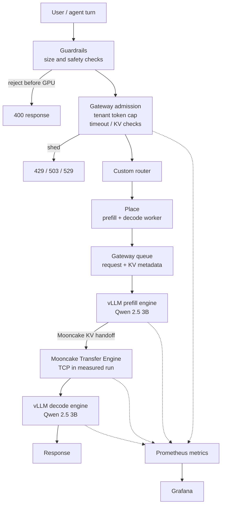

# GPU Inference Control Plane

An experimental Kubernetes control plane for serving a tool-using agent on a scarce GPU.

The project makes the decisions that are usually hidden behind a model endpoint explicit:

```text
guard → admit → place → queue → prefill → KV transfer → decode
```

It was deployed and exercised on a real Lambda **NVIDIA A100-SXM4-40GB**. The serving engine was **vLLM** running Qwen/Qwen2.5-3B-Instruct, with separate prefill and decode workers and a live Mooncake KV-transfer path.

Project journey: [Rohit Marwaha on Substack](https://rohitmarwaha.substack.com)

## The problem

LLM serving becomes a systems problem when GPU memory and compute are scarce. A tool-using agent is especially demanding: one user turn can produce several model generations, tool observations, and increasingly long contexts.

Sending every request directly to vLLM leaves important questions to the engine or to chance:

- Should this request reach a GPU at all?
- Is the tenant within its token budget?
- Which prefill and decode workers should handle it?
- Is the required KV state local, remotely transferable, or stale?
- Should a request wait, be rejected, or go to overflow?
- What happens when the KV handoff fails or a GPU slice is exhausted?

This project builds that control plane around vLLM. It does not reimplement vLLM's internal FCFS, priority, continuous-batching, chunked-prefill, or preemption scheduler. The control plane decides what work enters and where it goes; vLLM decides how admitted work executes.

## Architecture



The repository also includes rendered diagrams in [`diagrams/`](diagrams/), including the system, KV, and end-to-end views.

## Key design decisions

### Real engine, small model, measured hardware

The project uses a real A100 rather than brochure capacity. Qwen2.5-3B-Instruct runs in BF16. Its KV cost is:

```text
36 layers × 2 KV heads × 128 head dimension × 2 (K and V) × 2 BF16 bytes
= 36,864 bytes/token = 36 KiB/token
```

The model's 2,048-token limit implies approximately 72 MiB of KV per request before allocator overhead. vLLM reported approximately 41,744 prefill KV tokens and 41,008 decode KV tokens in the measured sliced deployment, equivalent to roughly 20.38× and 20.02× concurrency at the 2,048-token limit. These are engine-local capacities, not one shared pool.

### Prefill/decode disaggregation

Prefill and decode have different resource profiles:

- prefill is compute- and input-token-heavy;
- decode is sequential, slot-sensitive, and latency-sensitive.

They therefore run as two separate vLLM instances:

- `vllm-prefill`: KV producer, chunked prefill enabled;
- `vllm-decode`: KV consumer, priority scheduling and decode slots.

The Mooncake connector transfers KV state between the engines. Mooncake does not create one shared GPU KV pool: each engine owns its local GPU KV blocks, and the transfer layer moves the blocks needed by the receiving engine.

### HAMi GPU slicing

HAMi provides Kubernetes-visible memory and compute boundaries for the two workers. The final deployment requested two 16 GiB-class slices with 55 GPU-core units each on the 40 GiB A100. This created a reproducible experiment and made slice-OOM behavior observable, while accepting that static slices can sacrifice opportunistic utilization.

### Custom gateway and router

The gateway is a small OpenAI-compatible Python service, not llm-d or an Envoy-based proxy. Its purpose is to keep the control-plane decisions visible:

1. guard malformed or oversized input;
2. enforce tenant token budgets and admission limits;
3. place requests with load-, capability-, and prefix-aware policies;
4. build the prefill/decode queue and KV-transfer metadata;
5. classify failures as local, retryable, or eligible for overflow;
6. expose Prometheus metrics for every decision.

The router supports `least_loaded`, `p2c`, and `prefix_then_load` scoring. Prefill and decode are scored separately because queue depth, KV state, and latency have different meanings in each phase.

### Observability is part of the design

The project scrapes gateway, vLLM, Mooncake, HAMi, and DCGM metrics into Prometheus and Grafana. This makes the decisions auditable instead of relying only on request success counts.

## What was measured

The measurements below came from the final A100 deployment and the included evidence files. They are component measurements and pressure-test observations, not a claim of a universal benchmark.

| Area | Result | Evidence |
|---|---:|---|
| Prefill TTFT | ~16.6 ms average in the baseline snapshot | [`evidence/prefill-vllm-metrics.txt`](evidence/prefill-vllm-metrics.txt) |
| Decode TTFT | ~38.4 ms average in the baseline snapshot | [`evidence/decode-vllm-metrics.txt`](evidence/decode-vllm-metrics.txt) |
| Decode ITL | ~8.3 ms average across 5,929 measured intervals in a soak snapshot | [`evidence/`](evidence/) load snapshots |
| Mooncake transfer | normal transfers in the tens of ms; pressure run reached ~296 ms average and ~354 ms P90 | [`evidence/mooncake-proof.txt`](evidence/mooncake-proof.txt) |
| KV capacity | ~41.7k prefill tokens / ~41.0k decode tokens reported by vLLM | [`evidence/prefill-vllm-metrics.txt`](evidence/prefill-vllm-metrics.txt), [`evidence/decode-vllm-metrics.txt`](evidence/decode-vllm-metrics.txt) |
| Failure behavior | KV-transfer failures were surfaced as gateway 503s rather than silently claiming success | [`evidence/gateway-metrics.txt`](evidence/gateway-metrics.txt), [`evidence/kv-event-affinity.txt`](evidence/kv-event-affinity.txt) |

The measured Mooncake transport was **TCP**, not RDMA. The deployment logs show `No RDMA devices found` and `Using TCP transport (no HCA detected)`. RDMA is a natural next deployment on hardware with an HCA and GPUDirect RDMA support.

The most important finding was that the first practical limit was not simply theoretical KV capacity. Under pressure, transfer queueing and handoff reliability became visible before the advertised KV-token ceiling was exhausted. That is why the gateway treats KV-transfer failure, stale affinity, and timeout risk as first-class routing outcomes.

## Failure and control-plane behavior

- **Guardrail rejection:** malformed, blocked, or overlong input is rejected before a GPU request is created.
- **429:** tenant token budget exceeded; stay local and refuse until the window permits more work.
- **503:** worker unavailable, KV handoff rejected, or no eligible local pod; retry or overflow may be considered.
- **503 `slice_oom`:** stay local and refuse; moving the request does not make the current slice safe.
- **529:** upstream overload; eligible for overflow when the policy allows it.
- **KV event staleness:** exact affinity is disabled and the router falls back to aggregate metrics.
- **Eviction:** explicit `evict()` removes router-side residency metadata so the router does not continue to select a worker for KV that has already disappeared.

## Repository guide

| Path | Responsibility |
|---|---|
| [`app/guardrails.py`](app/guardrails.py) | Request inspection before admission |
| [`gateway/serve.py`](gateway/serve.py) | OpenAI-compatible HTTP entrypoint and `/metrics` |
| [`gateway/admission.py`](gateway/admission.py) | Token caps, admission, failure mapping |
| [`gateway/queue.py`](gateway/queue.py) | Prefill/decode handoff and KV metadata |
| [`gateway/metrics.py`](gateway/metrics.py) | Gateway Prometheus metrics |
| [`router/router.py`](router/router.py) | Worker selection and placement policies |
| [`router/pools.py`](router/pools.py) | vLLM worker snapshots and pool state |
| [`router/kv/`](router/kv/) | Mooncake connector, KV events, residency, and eviction |
| [`k8s-config/`](k8s-config/) | Kubernetes, HAMi, Prometheus, Grafana, and worker manifests |
| [`evidence/`](evidence/) | Deployment logs, metric scrapes, and test results |
| [`tests/`](tests/) | Focused unit and configuration tests |

## Run locally

The control-plane logic and tests can run without a GPU:

```bash
python3 -m venv .venv
source .venv/bin/activate
pip install -r requirements.txt
pytest -q
```

The local gateway can be started with:

```bash
python -m gateway.serve
```

For the full experiment, use a Linux host with an NVIDIA GPU, Kubernetes/k3s, HAMi, vLLM, Prometheus, and Grafana. The deployment scripts under [`setup/`](setup/) document the Lambda workflow used for the measured run.

## Project status and next steps

This is an engineering prototype designed to make inference-control decisions inspectable. The next production steps would be:

- run Mooncake over RDMA on HCA-equipped nodes;
- replace the custom gateway with or integrate it into llm-d/Gateway API inference infrastructure;
- add a persistent gateway queue with client-abort propagation;
- add a stitched request trace covering admission, prefill, KV transfer, and decode;
- evaluate dynamic worker scaling and compare vLLM with SGLang.
